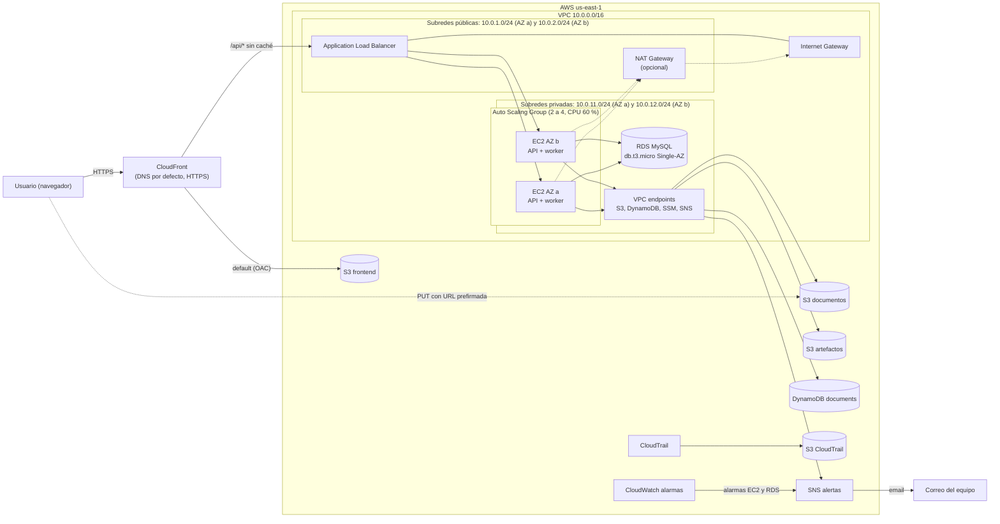

# DocuProcess Cloud

DocuProcess Cloud es un SaaS que procesa de forma asíncrona los documentos e imágenes que suben sus usuarios. El usuario sube el archivo directamente a S3 mediante una URL prefirmada; un worker lo toma de una cola lógica en DynamoDB, extrae sus metadatos (tamaño, tipo MIME, SHA-256, número de páginas o dimensiones) y avisa por SNS cuando termina. La plataforma se despliega en AWS (us-east-1) con Terraform dentro del Sandbox de AWS Academy, respetando sus restricciones: sin IAM propio, sin Lambda, con instancias y bases de datos pequeñas y con credenciales temporales.

Proyecto final del curso Infraestructura III, Universidad ICESI.

## Arquitectura



## Stack

- **Infraestructura:** Terraform y AWS (VPC, ALB, EC2 Auto Scaling, RDS MySQL, S3, DynamoDB, SNS, CloudFront, CloudWatch y CloudTrail).
- **Backend:** Python (API REST y worker como servicios systemd en Amazon Linux 2023).
- **Frontend:** HTML, CSS y JavaScript estáticos servidos por CloudFront.
- **Desarrollo local:** Docker Compose con MySQL y DynamoDB Local.
- **Integración continua:** GitHub Actions.

## Estructura del repositorio (prevista)

```
infra/              módulo raíz de Terraform
infra/modules/      network, compute, rds, storage, dynamodb, sns, cdn, monitoring
app/api/            API REST (autenticación y documentos)
app/worker/         worker de procesamiento asíncrono
frontend/           sitio estático
scripts/            userData, empaquetado, publicación del frontend y prueba de carga
docs/               arquitectura, RDS vs. DynamoDB y guía de despliegue
```

## Equipo y responsabilidades

| Integrante | Rol | Responsabilidades |
| --- | --- | --- |
| Persona A: Alejandro P | Plataforma y API | Módulos `network`, `compute` y `rds`; userData; API REST; escalado; prueba de carga; guía de despliegue |
| Persona B: Daniela C | Datos asíncronos y frontend | Módulos `storage`, `dynamodb`, `sns`, `cdn` y `monitoring`; worker; frontend; diagrama y justificación RDS vs. DynamoDB |

## Cronograma

| Fase | Fechas | Punto de control |
| --- | --- | --- |
| Base | Mié 4 a vie 6 nov | Vie 6: módulos base listos |
| Construcción | Sáb 7 a dom 8 nov | |
| Integración | Lun 9 a mar 10 nov | Mar 10: flujo end-to-end listo |
| Cierre | Mié 11 a jue 12 nov | |
| Entrega | Vie 13 nov | Vie 13: despliegue limpio |

## Tareas

Tablero: [GitHub Projects](https://github.com/users/Alejandroperezgarc1a/projects/5)

| ID | Tarea | Responsable | Fechas | Horas | Depende de |
| --- | --- | --- | --- | --- | --- |
| C1 | Kickoff: convenciones, contratos de integración y docker-compose de desarrollo | Ambos | Mié 4 | 3 + 3 | — |
| C2 | Módulo raíz de Terraform (provider, versions, variables, outputs, tfvars de ejemplo) | Ambos | Mié 4 | 2 + 2 | C1 |
| A1 | Spike de red: NAT Gateway vs. VPC endpoints en el Sandbox | A | Mié 4 | 2 | — |
| B1 | Spike de permisos del rol AmazonSSMRoleForInstancesQuickSetup | B | Mié 4 | 2 | — |
| A2 | Módulo network | A | Jue 5 – Vie 6 | 6 | A1 |
| B2 | Módulo storage (docs, frontend, artefactos) | B | Jue 5 | 3 | C2 |
| B3 | Módulo dynamodb | B | Jue 5 – Vie 6 | 3 | C1 |
| A6 | API REST | A | Jue 5 – Lun 9 | 8 | C1 |
| B6 | Worker de procesamiento | B | Jue 5 – Lun 9 | 8 | C1 |
| B4 | Módulo sns | B | Vie 6 | 2 | C2 |
| A3 | Módulo compute (ALB, ASG, launch template) | A | Sáb 7 – Dom 8 | 7 | A2 |
| A5 | Módulo rds | A | Sáb 7 | 3 | A2 |
| B5 | Módulo cdn (CloudFront) | B | Sáb 7 – Dom 8 | 5 | B2, A3 |
| B7 | Frontend estático | B | Sáb 7 – Lun 9 | 6 | C1 |
| A4 | userData y empaquetado de la aplicación (package-app.sh) | A | Dom 8 | 4 | A3 |
| C3 | Integración end-to-end en una sola cuenta | Ambos | Lun 9 – Mar 10 | 6 + 6 | A4, A6, B6, B7 |
| A7 | Escalado dinámico del ASG | A | Mar 10 | 2 | A3 |
| B8 | Script de publicación del frontend (deploy-frontend.sh) | B | Mar 10 | 2 | B5 |
| B9 | Módulo monitoring (alarmas EC2 y RDS, CloudTrail) | B | Mar 10 – Mié 11 | 4 | A3, A5, B4 |
| A8 | Prueba de carga (load-test.sh) y evidencias del ASG | A | Mié 11 | 4 | A7, C3 |
| A9 | Guía de despliegue y solución de problemas; completar "Cómo desplegar" del README | A | Mié 11 | 4 | C3 |
| B10 | Diagrama de arquitectura y justificación RDS vs. DynamoDB | B | Mié 11 | 4 | C3 |
| C4 | Despliegue desde cero en cuenta limpia | Ambos | Jue 12 | 2 + 2 | C3 |
| C5 | CI con GitHub Actions (Terraform, pruebas en Python 3.9, ShellCheck, empaquetado) | A | Mié 4 – Dom 8 | 2 | C1 |

## Cómo desplegar

En construcción (tarea A9).

## Desarrollo local

### Backend

```bash
cp .env.example .env          # completar DB_PASSWORD, MYSQL_ROOT_PASSWORD, JWT_SECRET y DOCS_BUCKET
docker compose up -d

# Crear la tabla documents con el comando de docs/architecture.md, sección 13.

cd app/api
python3.9 -m venv .venv
. .venv/bin/activate
pip install -r requirements.txt
set -a; . ../../.env; set +a
gunicorn --workers 2 --bind 0.0.0.0:8000 \
  --access-logfile - --error-logfile - app:app
```

### Frontend

```bash
cd frontend
npm install
npm run dev
```

El frontend queda en `http://localhost:5500`. Vite reenvía `/api` a
`http://localhost:8000`, así que no hace falta CORS en desarrollo.

Para probar el build de producción:

```bash
cd frontend
npm run build      # genera frontend/dist/
npm run preview    # sirve dist/ en http://127.0.0.1:4173
```

El despliegue debe subir `frontend/dist/`, no el código fuente.

#### CORS del bucket de documentos

El `PUT` a S3 es directo desde el navegador. El bucket debe permitir el
origen local y, en producción, el dominio de CloudFront:

```bash
aws s3api put-bucket-cors \
  --bucket "$DOCS_BUCKET" \
  --cors-configuration '{
    "CORSRules": [{
      "AllowedOrigins": [
        "http://localhost:5500",
        "http://127.0.0.1:5500"
      ],
      "AllowedMethods": ["PUT", "GET", "HEAD"],
      "AllowedHeaders": ["Content-Type"],
      "ExposeHeaders": ["ETag"],
      "MaxAgeSeconds": 3000
    }]
  }'
```

En Terraform esto corresponde al módulo de storage (B2) y al dominio de
CloudFront (B5).

## Cómo trabajamos

- Una rama por tarea: `feat/<ID>-descripcion` (por ejemplo `feat/A2-modulo-network`).
- Commits en formato Conventional Commits con el ID de la tarea: `feat(network): A2 subredes privadas en 2 AZ`.
- Cada PR lo revisa el otro integrante y cierra su issue con `Closes #n`.
- Cada PR debe pasar el CI (GitHub Actions): formato y validación de Terraform, pruebas en Python 3.9, ShellCheck y empaquetado. `main` no acepta merges con checks en rojo.
