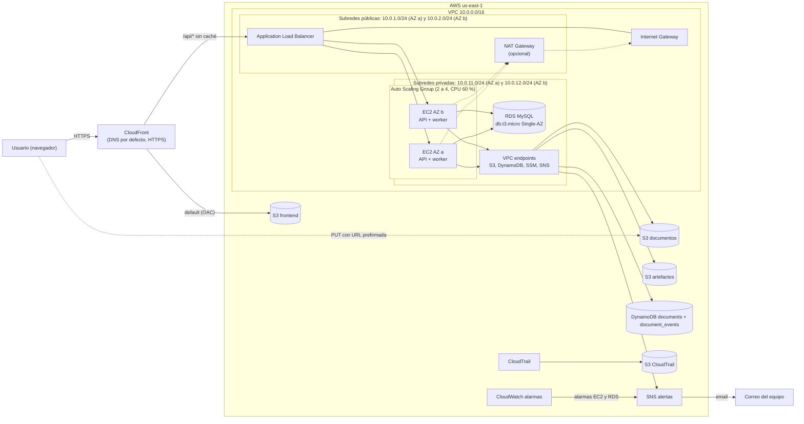

# DocuProcess Cloud

DocuProcess Cloud es un SaaS que procesa de forma asíncrona los documentos e imágenes que suben sus usuarios. El usuario sube el archivo directamente a S3 mediante una URL prefirmada; un worker lo toma de una cola lógica en DynamoDB, extrae sus metadatos (tamaño, tipo MIME, SHA-256, número de páginas o dimensiones), registra cada cambio de estado en una bitácora auditable y avisa por SNS cuando termina. La plataforma se despliega en AWS (us-east-1) con Terraform dentro del Sandbox de AWS Academy, respetando sus restricciones: sin IAM propio, sin Lambda, con instancias y bases de datos pequeñas y con credenciales temporales.

Proyecto final del curso Infraestructura III, Universidad ICESI.

## Arquitectura



## Stack

- **Infraestructura:** Terraform y AWS (VPC, ALB, EC2 Auto Scaling, RDS MySQL, S3, DynamoDB, SNS, CloudFront, CloudWatch y CloudTrail).
- **Backend:** Node.js 24 + TypeScript (API REST con Express 5; worker de procesamiento previsto en Node.js) como servicios systemd en Amazon Linux 2023.
- **Frontend:** HTML, CSS y JavaScript con Vite; build estático servido por CloudFront.
- **Desarrollo local:** Docker Compose con MySQL y DynamoDB Local.
- **Integración continua:** GitHub Actions.

## API

- Documentación interactiva (Swagger UI): `/api/docs`
- Especificación OpenAPI 3.0: `/api/openapi.json`

## Estructura del repositorio (prevista)

```
infra/              módulo raíz de Terraform
infra/modules/      network, compute, rds, storage, dynamodb, sns, cdn, monitoring
app/api/            API REST en Node.js + TypeScript (src/, tests/)
app/worker/         worker de procesamiento asíncrono (pendiente, Node.js)
frontend/           sitio estático
scripts/            userData, empaquetado, publicación del frontend y prueba de carga
docs/               arquitectura, RDS vs. DynamoDB, trazabilidad y guía de despliegue
```

## Equipo y responsabilidades

| Integrante | Rol | Responsabilidades |
| --- | --- | --- |
| Persona A: Alejandro P | Plataforma y API | Módulos `network`, `compute` y `rds`; userData; API REST; escalado; prueba de carga; guía de despliegue |
| Persona B: Daniela C | Datos asíncronos y frontend | Módulos `storage`, `dynamodb`, `sns`, `cdn` y `monitoring`; worker; frontend; diagrama y justificación RDS vs. DynamoDB |

## Cronograma y tareas

El tablero de [GitHub Projects](https://github.com/users/Alejandroperezgarc1a/projects/5) es la fuente única de verdad para tareas, responsables, fechas, horas y dependencias. El README no duplica esa información.

## Cómo desplegar

La guía completa (requisitos, credenciales del Sandbox y solución de problemas) llega con la tarea A9. El orden mínimo es:

```bash
cp infra/terraform.tfvars.example infra/terraform.tfvars   # completar alert_email, db_password y jwt_secret
./scripts/package-app.sh                                    # genera dist/docuprocess-app.zip (Node 24 + zip)
terraform -chdir=infra init
terraform -chdir=infra apply
```

`package-app.sh` va **antes** de cada `apply` que deba llevar código nuevo: Terraform sube el zip con su hash en el nombre y, si cambió, reemplaza las instancias sin caída del servicio.

## Desarrollo local

### Backend

```bash
cp .env.example .env          # completar DB_PASSWORD, MYSQL_ROOT_PASSWORD, JWT_SECRET y DOCS_BUCKET
docker compose up -d

# Crear las tablas documents y document_events con los comandos de docs/architecture.md, sección 13.

cd app/api
npm ci
npm run build
set -a; . ../../.env; set +a
PORT=8000 WEB_CONCURRENCY=2 node dist/server.js
```

En desarrollo con recarga automática: `npm run dev`.

Swagger UI: `http://localhost:8000/api/docs`.

### Frontend

```bash
cd frontend
npm install
npm run dev
```

El frontend queda en `http://localhost:5500`. Vite reenvía `/api` a
`http://localhost:8000`, así que no hace falta CORS en desarrollo.

Para probar el build de producción:

```bash
cd frontend
npm ci
npm run build      # genera frontend/dist/
npm run preview    # sirve dist/ en http://127.0.0.1:4173
```

El despliegue debe subir `frontend/dist/`, no el código fuente.

#### CORS del bucket de documentos

El `PUT` a S3 es directo desde el navegador. El bucket debe permitir el
origen local y, en producción, el dominio de CloudFront:

```bash
aws s3api put-bucket-cors \
  --bucket "$DOCS_BUCKET" \
  --cors-configuration '{
    "CORSRules": [{
      "AllowedOrigins": [
        "http://localhost:5500",
        "http://127.0.0.1:5500"
      ],
      "AllowedMethods": ["PUT", "GET", "HEAD"],
      "AllowedHeaders": ["Content-Type"],
      "ExposeHeaders": ["ETag"],
      "MaxAgeSeconds": 3000
    }]
  }'
```

En Terraform esto corresponde al módulo de storage (B2) y al dominio de
CloudFront (B5).

## Cómo trabajamos

- Una rama por tarea: `feat/<ID>-descripcion` (por ejemplo `feat/A2-modulo-network`).
- Commits en formato Conventional Commits con el ID de la tarea: `feat(network): A2 subredes privadas en 2 AZ`.
- Cada PR lo revisa el otro integrante y cierra su issue con `Closes #n`.
- Cada PR debe pasar el CI (GitHub Actions): formato y validación de Terraform, pruebas en Node.js 24 (build, tipos y tests), ShellCheck y empaquetado. `main` no acepta merges con checks en rojo.
