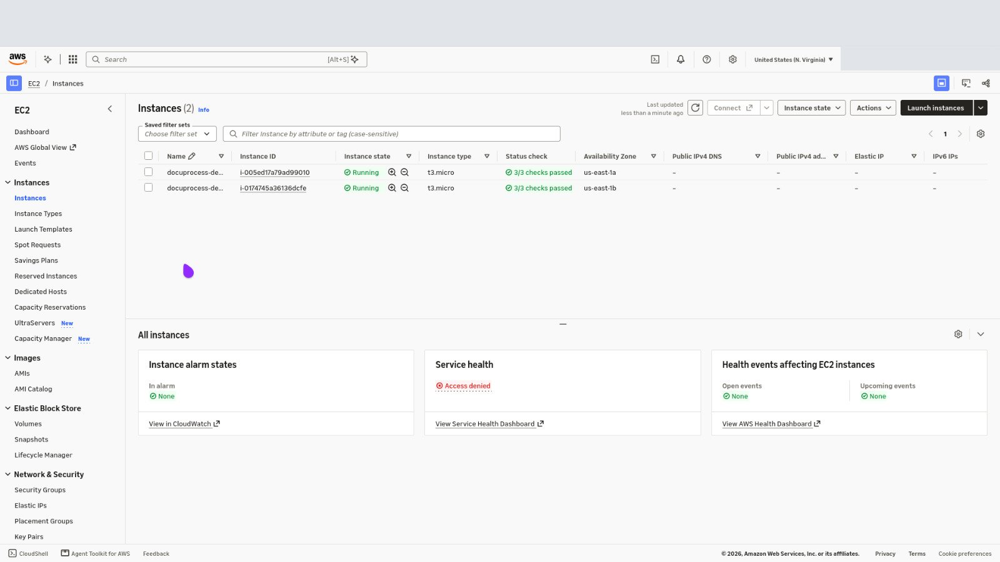
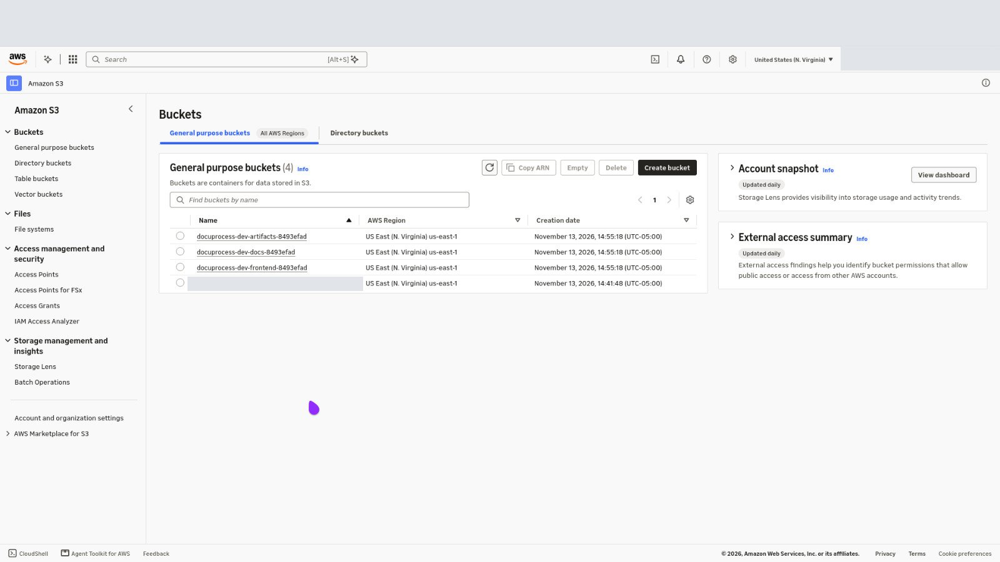
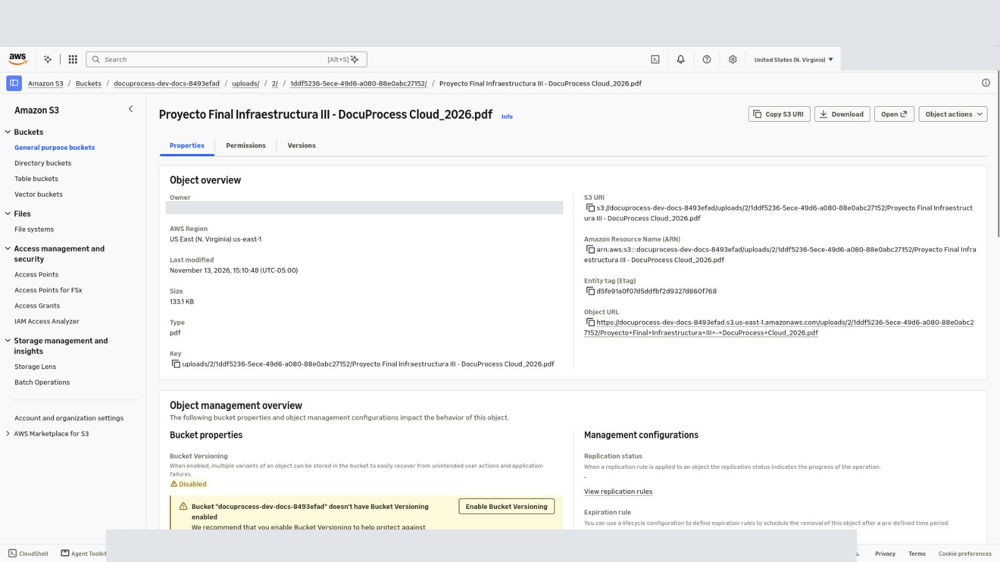

# Informe C4 — Despliegue desde cero en cuenta limpia

> **Estado (2026-11-13 ~17:00–18:00 UTC): ejecutado.** Despliegue en vivo desde `main` en la sesión de entrega, cuenta voclabs (<AWS_ACCOUNT_ID>), el mismo día de la entrega final (13 de noviembre de 2026). Este documento refleja lo ocurrido, sin adornos.

## Objetivo

Demostrar y documentar el despliegue completo de DocuProcess Cloud desde una cuenta/laboratorio **vacío**, sin pasos manuales ocultos: IaC + scripts + verificación E2E.

## Qué pasó realmente (2026-11-13)

El laboratorio **no estaba limpio**: al reutilizarlo, conservó recursos de un despliegue anterior del mismo día.

- **Borrados por el reset del lab**: EC2/ASG/ALB/CloudFront (NXDOMAIN confirmado al consultar el DNS de la mañana).
- **Sobrevivientes**:
  - RDS `docuprocess-dev-mysql` (siguió `available` durante todo el día).
  - Parámetros SSM `SecureString` `/docuprocess-dev/db_password` y `/docuprocess-dev/jwt_secret` (versión 1).
  - OAC de CloudFront `E3WD19JOMQIQV` (`docuprocess-dev-frontend-oac`).
- **Primer apply (tfplan, 73 recursos)**: falló en 3 recursos — los dos `aws_ssm_parameter` (`ParameterAlreadyExists`) y `module.cdn.aws_cloudfront_origin_access_control.frontend` (`OriginAccessControlAlreadyExists`). Sus dependientes no llegaron a crearse.
- **Resolución** (solo bookkeeping, sin borrar ni mutar la cuenta): `terraform import` de los 3 huérfanos → re-`plan` → **7 to add, 0 change, 0 destroy** → segundo `apply` **OK**:
  `module.cdn.aws_cloudfront_distribution.this`, `module.cdn.aws_s3_bucket_policy.frontend`, `module.compute.aws_launch_template.app`, `module.compute.aws_autoscaling_group.app`, `module.compute.aws_autoscaling_policy.cpu`, `module.monitoring.aws_cloudwatch_metric_alarm.ec2_cpu`, `module.storage.aws_s3_bucket_cors_configuration.docs`.
- Lección para `docs/guias/despliegue.md`: el lab voclabs **no** resetea SSM params ni OAC; "desde cero" en voclabs requiere el import de huérfanos cuando el lab se reutiliza el mismo día. La guía ya cubre el caso `ParameterAlreadyExists`.

## Estado final del stack (verificado en vivo 2026-11-13)

| Recurso | Estado |
| --- | --- |
| VPC `vpc-00f41a2667db6ffc4` | OK |
| ALB `docuprocess-dev-alb` | OK; TG `docuprocess-dev-app` :8000, health `/api/health` |
| ASG `docuprocess-dev-app-v1` | Desired=2, InService=2 |
| Targets | 2/2 **healthy** |
| CloudFront | `d39qhfy6fiy63b.cloudfront.net` (dist `E2587IYX3FWIVO`) |
| Buckets S3 | `docuprocess-dev-{docs,frontend,artifacts}-77d1730d` |
| RDS `docuprocess-dev-mysql` | `available` (reutilizado; db.t3.micro Single-AZ) |
| DynamoDB | `documents`, `document_events` activas |
| SNS `docuprocess-dev-alerts` | suscripción `<TEAM_EMAIL>` = **PendingConfirmation** al desplegar; confirmada después (13-nov) |
| CloudTrail | modo `event-history` (sin trails; documentado) |
| Alarmas (4) | todas **OK**, 1 acción hacia SNS |

## Verificación E2E (vía CloudFront, 2026-11-13 ~17:50 UTC)

1. `GET /api/health` → 200; `GET /api/ready` → 200.
2. Registro `demo-final-13nov@example.com` → 201 (`id: 1`); login → token JWT.
3. `POST /api/documents` (`enunciado-demo.pdf`, application/pdf, 136 265 B) → presigned PUT; PUT a S3 → 200.
4. Worker procesó el documento `adf1248b-e498-4bda-8c1e-46271043da23` → **DONE**: `result={mimeType: application/pdf, pages: 7, sha256: 9bef8e2d…, sizeBytes: 136265}`.

## Notas de la sesión

- Las APIs de lectura **sí funcionaron** en esta sesión (a diferencia de la sesión previa temprano ese mismo día, que vio denegaciones SCP).
- Los IDs de esta sección (VPC, buckets, CloudFront) corresponden a este despliegue final; las sesiones anteriores del mismo día (C3/B9) usaron otros IDs.
- El RDS sobrevivió al reset del lab: no es un "desde cero" de datos, pero sí de infraestructura de aplicación/edge/alarma.
- La suscripción SNS quedó `PendingConfirmation` al desplegar; se confirmó el buzón después ese mismo día (13-nov), así que las alertas ya se entregan (ver la evidencia de monitoreo).
- `terraform destroy` no se ejecutó (el stack se conserva para la defensa/demo).

### Capturas de la consola (primera corrida)

Respaldo visual de la primera corrida, por si la demostración en vivo falla. Se censuraron el ID de cuenta, el usuario del Sandbox, la barra del navegador y un bucket de pruebas locales que no crea Terraform.

| Captura | Qué muestra |
| --- | --- |
|  | EC2: las 2 instancias `t3.micro` del ASG en `Running` con 3/3 checks, una en `us-east-1a` y otra en `us-east-1b`, sin IP pública |
|  | S3: los 3 buckets que crea Terraform (`artifacts`, `docs`, `frontend`) con el mismo sufijo aleatorio |
|  | S3: un PDF subido desde el navegador con la URL prefirmada, en `uploads/<userId>/<documentId>/` del bucket de documentos |

## Segunda corrida: cuenta vacía verificada (2026-11-13, ~21:03–21:55 UTC)

Corrida independiente en otra cuenta del Sandbox para cumplir el criterio de "plantilla limpia" sin importar huérfanos: clon nuevo desde GitHub (`main` = `93a2209`, B11 incluido), sin estado de Terraform y con la cuenta comprobada vacía antes de empezar (`./scripts/verify-deployment.sh limpieza` → 12/12).

| Paso | Resultado | Tiempo |
| --- | --- | --- |
| Cuenta vacía antes del apply | 12/12 sin restos (EC2, ASG, ALB, RDS, DynamoDB, S3, SSM, CloudFront, SNS, alarmas, VPC) | — |
| `terraform apply` | `Plan: 73 to add, 0 to change, 0 to destroy` → `Apply complete! Resources: 73 added`, sin errores ni pasos manuales | 10 min 15 s |
| `deploy-frontend.sh` | Build, sincronización a S3 e invalidación de CloudFront | 38 s |
| `verify-deployment.sh` | 16/16: ASG 2/2 InService, 2 targets healthy, 2 instancias Online en SSM, target tracking, RDS `available` Single-AZ, 2 tablas `ACTIVE`, 4 alarmas, SNS confirmada, CloudTrail, health profundo, frontend 200, API sin token 401, ALB 200; `plan` estable (sin cambios) | ~1 min |
| `e2e-test.sh` (1.ª corrida) | 20/22: **`fake.pdf` quedó en `PROCESSING`** (hallazgo, ver abajo) | — |
| Arreglo + redespliegue del worker | Artefacto nuevo → ASG nuevo azul/verde; **96/96 health 200 durante el reemplazo** | 3 min 42 s |
| `e2e-test.sh` (3 corridas tras el arreglo + 1 final) | 22/22 en cada una; PDF y PNG → `DONE`, PDF falso → `FAILED`, bitácora de 3 eventos, 404 entre usuarios, 401 sin token; 3 correos de SNS recibidos | ~1 s de procesamiento |
| `terraform destroy` | `Destroy complete! Resources: 73 destroyed` | 6 min 59 s |
| Cuenta vacía después del destroy | 12/12 sin restos | — |

### Hallazgo 1: condición de carrera entre workers (corregido en este PR)

Con tres subidas seguidas, los dos workers consultaron el mismo ítem a la vez. Uno lo reclamó y lo marcó `FAILED`; el claim del otro coincidió en el mismo instante y DynamoDB canceló la transacción del ganador con `TransactionConflict` (`fail_transition_failed` en `journalctl`). El worker no reintentaba, así que el documento quedó en `PROCESSING` para siempre. No es lo mismo que `ConditionalCheckFailed` (otro ganó): es un conflicto transitorio que el SDK no reintenta.

Arreglo: el worker reintenta las transiciones canceladas por `TransactionConflict` hasta 5 veces con espera exponencial y jitter (`withConflictRetry`); reintentar es seguro porque las transiciones son condicionales e idempotentes. Verificado en AWS: tras el arreglo hubo 3 `claim_lost` (competencia real entre workers) y 0 `fail_transition_failed`.

### Hallazgo 2: el correo de confirmación de SNS no llegaba

`alert_email` en el `terraform.tfvars` local era una dirección de ejemplo (`@example.com`), así que la confirmación nunca llegó a nadie (en las corridas anteriores las alarmas sí publicaban al tópico, lo que no exige suscripción confirmada). Se corrigió el valor y un `apply` reemplazó solo la suscripción. La suscripción pendiente vieja no se puede borrar: AWS la expira a los 3 días, por eso `verify-deployment.sh` exige al menos una confirmada.

### Versión desplegada

La corrida usó `main` en `93a2209` más el arreglo del worker de este PR. Mientras corría se fusionó #60, cuyo único cambio fuera de `docs/` es un comentario de `scripts/user-data.sh.tftpl`; la infraestructura probada es la misma que la de `main` con este PR.

## Conclusión

C4 queda **demostrado en la fecha de entrega** (2026-11-13), con la salvedad honesta de que el laboratorio voclabs no ofrece un "vacío real": la limpieza de huérfanos (2 SSM params + 1 OAC) fue parte del ejercicio y está documentada para reproducirla. El procedimiento completo (credenciales → tfvars → package-app → apply → SNS → deploy-frontend → E2E → destroy) vive en `docs/guias/despliegue.md`.

La segunda corrida (cuenta vacía verificada antes y después, 73 recursos creados y destruidos sin pasos manuales salvo confirmar el correo de SNS) cumple el criterio sin salvedades y dejó dos hallazgos corregidos. Para repetirla: `./scripts/verify-deployment.sh limpieza` → `package-app.sh` → `apply` → `deploy-frontend.sh` → confirmar SNS → `verify-deployment.sh` → `e2e-test.sh` → `destroy` → `verify-deployment.sh limpieza`.
