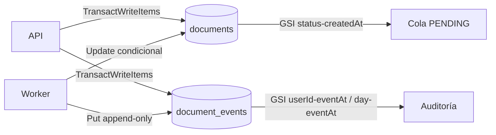

# Arquitectura de DocuProcess Cloud

> Las secciones de diagrama detallado, flujo de un documento y tabla de componentes se completan en la tarea B10. Este documento empieza con los **contratos de integración** (C1): la fuente de verdad que comparten la API, el worker, el frontend y Terraform. Todo cambio a un contrato se hace con un PR que actualice esta sección.

## Contratos de integración

### 1. API: framework y ejecución

- **Express 5 sobre Node.js 24 + TypeScript**, escuchando en `0.0.0.0:8000` con 2 workers (cluster).
- Por qué Express y no Fastify:
  - La API es pequeña y el equipo ya conoce Express; Express 5 reenvía automáticamente los errores de handlers `async`.
  - Todas las dependencias son JavaScript puro (sin binarios nativos), lo que simplifica el empaquetado de A4.
  - El cluster de Node replica los 2 workers síncronos del diseño anterior.
- **Node.js 24** en las instancias (paquete `nodejs24` de Amazon Linux 2023).

### 2. Servicios en las instancias

| Elemento | Valor |
| --- | --- |
| Código | `/opt/docuprocess/{api,worker}` |
| Entorno de ejecución | `/opt/docuprocess/{api,worker}/dist` + `node_modules` vendorizado |
| Configuración | `/etc/docuprocess.env` (permisos 600, dueño root) |
| Unidades systemd | `docuprocess-api.service`, `docuprocess-worker.service` (`EnvironmentFile=/etc/docuprocess.env`, `Restart=always`) |
| Arranque de la API | `node /opt/docuprocess/api/dist/server.js` con `WEB_CONCURRENCY=2` |
| Arranque del worker | `node /opt/docuprocess/worker/dist/worker.js` (un proceso por instancia) |
| Usuario del sistema | `docuprocess` |
| Logs | stdout/stderr → journald (`journalctl -u docuprocess-api`, `journalctl -u docuprocess-worker`) |
| Log del arranque | `/var/log/docuprocess-userdata.log` |

### 3. Variables de entorno

| Variable | Origen en AWS | Usa | Local (`.env`) |
| --- | --- | --- | --- |
| `DOCS_BUCKET` | `module.storage.docs_bucket_name` | API, worker | bucket real (obligatorio para la API) |
| `DDB_TABLE` | `module.dynamodb.table_name` | API, worker | `documents` |
| `DDB_EVENTS_TABLE` | `module.dynamodb.events_table_name` | API, worker | `document_events` |
| `DDB_TRANSACTIONS` | `var.enable_dynamodb_transactions` (`true`) | API, worker | `true` |
| `SNS_TOPIC_ARN` | `module.sns.topic_arn` | worker | vacío (solo log) |
| `DB_HOST` | `module.rds.db_address` | API | `127.0.0.1` |
| `DB_PORT` | `module.rds.db_port` (opcional, 3306) | API | `3306` |
| `DB_NAME` | `var.db_name` | API | `docuprocess` |
| `DB_USER` | `var.db_username` | API | `docuadmin` |
| `DB_PASSWORD` | Parameter Store `/<name_prefix>/db_password` (SecureString, lo lee el userData) | API | `.env` |
| `JWT_SECRET` | Parameter Store `/<name_prefix>/jwt_secret` (SecureString, lo lee el userData) | API | `.env` |
| `AWS_REGION` | `var.aws_region` | API, worker | `us-east-1` |
| `ARTIFACTS_BUCKET` | `module.storage.artifacts_bucket_name` | userData | vacío |
| `DDB_ENDPOINT_URL` | **no se define** | API, worker | `http://localhost:8001` |
| `CORS_ALLOWED_ORIGINS` | **no se define** (mismo origen vía CloudFront) | API | `http://localhost:5500` |
| `WORKER_POLL_SECONDS` | `var.worker_poll_seconds` (5) | worker | `5` |
| `WORKER_BATCH_SIZE` | `var.worker_batch_size` (10) | worker | `10` |
| `UPLOAD_TIMEOUT_MINUTES` | `var.upload_timeout_minutes` (15) | worker | `15` |
| `MAX_FILE_MB` | `var.max_file_mb` (10) | worker | `10` |
| `LOG_LEVEL` | fijo `INFO` en AWS | worker | `INFO` |

Reglas:
- La aplicación **falla al arrancar** si falta una variable obligatoria (configuración por entorno, al estilo 12-factor).
- `DOCS_BUCKET` no puede estar vacío: la API falla al arrancar.
- El AWS SDK v3 recibe `region: config.awsRegion` explícitamente.
- Si `DDB_ENDPOINT_URL` está definida, se pasa como `endpoint_url` al cliente de DynamoDB.
- `DDB_EVENTS_TABLE` es obligatoria: sin bitácora la API no arranca (falla rápido, no a medias).
- `DDB_TRANSACTIONS=false` es solo un **fallback del Sandbox**: escribe el documento y luego el evento sin atomicidad. En AWS normal se deja `true`.
- En AWS, las credenciales vienen del instance profile vía IMDSv2; nunca se escriben en código ni en archivos.

### 4. Ítem de DynamoDB (tabla `documents`)

| Atributo | Tipo | Descripción |
| --- | --- | --- |
| `documentId` | S (PK) | UUID v4 |
| `userId` | S | `id` del usuario en MySQL, como string |
| `filename` | S | Nombre original saneado |
| `contentType` | S | Tipo declarado por el cliente |
| `s3Key` | S | `uploads/{userId}/{documentId}/{filename}` |
| `status` | S | `PENDING`, `PROCESSING`, `DONE` o `FAILED` |
| `createdAt` | S | ISO-8601 UTC con milisegundos: `2026-11-05T14:03:22.123Z` (ordena bien como string) |
| `updatedAt` | S | Igual formato |
| `result` | M | Solo en `DONE`: `sizeBytes` (N), `mimeType` (S), `sha256` (S), `pages` (N, PDF), `width` y `height` (N, imágenes) |
| `error` | S | Solo en `FAILED` |

Índices:
- `userId-createdAt`: la lista de documentos de un usuario, del más reciente al más antiguo.
- `status-createdAt`: el worker busca los `PENDING` más antiguos.

Ciclo de vida de un documento:
```
PENDING ──(worker reclama con update condicional)──► PROCESSING ──► DONE
   │                                                      └──────► FAILED (error)
   └──(archivo no subido en 15 min)──► FAILED ("upload timeout")
```

`status` es palabra reservada de DynamoDB: siempre va en `ExpressionAttributeNames` (`#s`).

#### 4.1. Bitácora auditable (`document_events`)

`documents` guarda el **estado actual** (se sobrescribe). El **historial** vive en una tabla
separada, `document_events`, que es *append-only*: la política del rol solo permite `PutItem`,
`GetItem` y `Query`; las transacciones se autorizan con las acciones de cada ítem. No puede
actualizar ni borrar eventos.

| Atributo | Tipo | Descripción |
| --- | --- | --- |
| `documentId` | S (PK) | UUID del documento |
| `eventAt` | S (SK) | ISO-8601 UTC con ms + `#` + 6 hex: `2026-11-11T14:03:22.123Z#a1b2c3`. El sufijo evita colisiones en el mismo milisegundo |
| `eventId` | S | UUID v4 del evento |
| `userId` | S | Dueño del documento (string) |
| `eventDay` | S | `YYYY-MM-DD` UTC (clave del GSI `day-eventAt`) |
| `fromStatus` | S | Estado anterior; ausente en el evento de creación |
| `toStatus` | S | Estado nuevo |
| `actor` | S | `api`, `worker` o `system` |
| `reason` | S | Motivo legible (opcional) |
| `error` | S | Detalle del fallo (opcional) |
| `requestId` | S | Correlación con logs (opcional) |
| `schemaVersion` | N | Versión del esquema del evento (hoy `1`) |

Índices: `userId-eventAt` (auditoría de un usuario entre documentos) y `day-eventAt`
(auditoría global por día). La creación usa `TransactWriteItems`: el `Put` del documento y el
`Put` del evento se confirman juntos o ninguno. La condición del documento
(`attribute_not_exists(documentId)`) evita sobrescribir uno existente; la del evento
(`attribute_not_exists(eventAt)`) protege su clave exacta y no limita los demás eventos del
documento. El resto de transiciones las hará el worker con un `Update` condicional del documento
(`#s = :from`) + `Put` del evento.

El worker escribe `PENDING→PROCESSING`, `PROCESSING→DONE`, `PROCESSING→FAILED` y
`PENDING→FAILED` (timeout de subida) con `actor="worker"`. Si `DDB_TRANSACTIONS=true`, el
`Update` del documento y el `Put` del evento van en un `TransactWriteItems`; si es `false`, se
escriben secuencialmente como respaldo del Sandbox.



### 5. Clave en S3

`uploads/{userId}/{documentId}/{filename}`. El nombre se sanea: sin `/`, sin `\`, sin caracteres de control y con un máximo de 200 caracteres. El `documentId` en la ruta evita colisiones entre archivos con el mismo nombre.

### 6. Autenticación (JWT)

- HS256 firmado con `JWT_SECRET`. Claims: `sub` (userId como string), `email`, `iat` y `exp` (1 hora).
- Header: `Authorization: Bearer <token>`.
- Contraseñas con bcrypt (cost 12). Esto también es lo que genera carga de CPU en la prueba de A8.

### 7. API HTTP

Todas las rutas empiezan por `/api` (CloudFront enruta `/api/*` al ALB). JSON en request y response.

| Método y ruta | Auth | Request | Respuesta exitosa | Errores |
| --- | --- | --- | --- | --- |
| `GET /api/health` | No | — | `200 {"status":"ok"}` (no toca la base) | — |
| `GET /api/ready` | No | — | `200 {"status":"ready","checks":{"mysql":"ok"}}` (`SELECT 1` a MySQL) | 503 |
| `POST /api/auth/register` | No | `{email, password}` (≥ 8 caracteres) | `201 {id, email}` | 400, 409 |
| `POST /api/auth/login` | No | `{email, password}` | `200 {token, expiresIn: 3600}` | 400, 401 |
| `POST /api/documents` | Sí | `{filename, contentType, size}` | `201 {documentId, uploadUrl, method:"PUT", headers:{"Content-Type"}, key, expiresIn: 900}` | 400, 401 |
| `GET /api/documents` | Sí | — | `200 {items:[…]}` (máx. 50, más recientes primero) | 401 |
| `GET /api/documents/{id}` | Sí | — | `200 {…ítem…}` | 401, 404 (no existe o es de otro usuario) |
| `GET /api/documents/{id}/events` | Sí | — | `200 {items:[…]}` (bitácora ascendente, máx. 200) | 401, 404, 503 |

Formato de error: `{"error": "<codigo>", "message": "<texto legible>"}`.

### 8. Archivos permitidos

`application/pdf`, `image/png`, `image/jpeg` y `text/plain`, con un máximo de **10 MB**. Lo valida el frontend (B8), la API sobre lo declarado (A6) y el worker sobre el archivo real (B5). Una URL prefirmada de tipo PUT no puede imponer el tamaño, por eso el worker es la última barrera. El worker detecta el MIME por magic bytes (`file-type`) y, si no hay firma conocida, acepta UTF-8 válido como `text/plain`; rechaza el resto.

### 9. Notificación SNS (worker)

- Subject: `DocuProcess: <filename> <status>` (máximo 100 caracteres, el límite de SNS).
- Cuerpo JSON: `{"documentId", "userId", "filename", "status", "error"?}`.
- Si `SNS_TOPIC_ARN` está vacío (desarrollo local), el worker escribe el mensaje en el log.
- La suscripción de correo queda en `PendingConfirmation` hasta que el destinatario pulsa el enlace del correo de AWS. Terraform no puede confirmarla ni borrar una suscripción sin confirmar; hay que confirmarla después del `apply` antes de la demostración.

### 10. Nombres en Terraform

**Locals compartidos (raíz):** `name_prefix = "${project_name}-${environment}"` (por defecto `docuprocess-dev`), `instance_profile_name` (descubierto) y `app_role_arn` (construido).

**Variables raíz:** ver `infra/variables.tf` (C2). Las principales son `aws_region`, `project_name`, `environment`, `azs`, `vpc_cidr`, `public_subnet_cidrs`, `private_subnet_cidrs`, `enable_nat_gateway`, `enable_interface_endpoints`, `instance_type`, `instance_role_name`, `asg_min_size`, `asg_max_size`, `asg_desired_capacity`, `cpu_target_value`, `root_volume_size`, `db_name`, `db_username`, `db_password`, `jwt_secret`, `alert_email`, `dynamodb_table_name`, `document_events_table_name`, `enable_dynamodb_transactions`, `enable_point_in_time_recovery`, `worker_poll_seconds`, `worker_batch_size`, `upload_timeout_minutes`, `max_file_mb`, `app_artifact_path`, `cors_allowed_origins` y `force_destroy_buckets`.

**Outputs por módulo** (nombres exactos):

| Módulo | Outputs |
| --- | --- |
| network | `vpc_id`, `public_subnet_ids`, `private_subnet_ids`, `private_route_table_ids`, `alb_security_group_id`, `app_security_group_id`, `rds_security_group_id` |
| compute | `alb_dns_name`, `alb_arn_suffix`, `target_group_arn_suffix`, `asg_name`, `launch_template_id` |
| rds | `db_address`, `db_port`, `db_instance_identifier` |
| storage | `docs_bucket_name`, `docs_bucket_arn`, `frontend_bucket_name`, `frontend_bucket_arn`, `frontend_bucket_regional_domain_name`, `artifacts_bucket_name`, `artifacts_bucket_arn` |
| dynamodb | `table_name`, `table_arn`, `events_table_name`, `events_table_arn` |
| sns | `topic_arn`, `topic_name` |
| cdn | `cloudfront_domain_name`, `distribution_id`, `distribution_arn` |
| monitoring | `alarm_names`, `cloudtrail_bucket_name`, `cloudtrail_arn` |

**Outputs raíz:** `alb_dns_name`, `cloudfront_domain_name`, `cloudfront_distribution_id`, `app_url`, `docs_bucket_name`, `frontend_bucket_name`, `artifacts_bucket_name`, `dynamodb_table_name`, `dynamodb_events_table_name`, `sns_topic_arn`, `rds_endpoint`, `asg_name` y `vpc_id`.

### 11. Permisos de la aplicación: políticas basadas en recursos

El rol de las instancias (`AmazonSSMRoleForInstancesQuickSetup`) **solo tiene permisos de SSM** (ver la sección 12). Cada módulo de datos recibe `app_role_arn` y concede lo mínimo **en su propio recurso**:

| Recurso | Política | Acciones concedidas al rol |
| --- | --- | --- |
| Bucket de documentos | bucket policy | `s3:GetObject` y `s3:PutObject` sobre `uploads/*` |
| Bucket de artefactos | bucket policy | `s3:GetObject` sobre `releases/*` |
| Tabla `documents` e índices | DynamoDB resource policy | `GetItem`, `PutItem`, `UpdateItem`, `Query` (las transacciones usan estas acciones) |
| Tabla `document_events` e índices | DynamoDB resource policy | `GetItem`, `PutItem`, `Query` (sin `UpdateItem`/`DeleteItem`: append-only; las transacciones usan estas acciones) |
| Tópico de alertas | topic policy | `sns:Publish` (y `sns:Publish` para `cloudwatch.amazonaws.com`, por las alarmas) |
| Parámetros `/<name_prefix>/*` | ya cubierto por el rol (`ssm:*` sobre parámetros) | `ssm:GetParameter` |

La app **no** debe usar operaciones de listado de cuenta (`ListBuckets`, `ListTables`, `ListTopics`) ni STS: no están permitidas ni son alcanzables sin NAT.

### 12. Hallazgos del Sandbox (spike A1, 2026-11-04)

| Hallazgo | Consecuencia en el diseño |
| --- | --- |
| El rol de las EC2 solo tiene `AmazonSSMManagedInstanceCore` + `ssm:*` sobre `parameter/*` | Permisos de la app por políticas basadas en recursos (sección 11); secretos en Parameter Store |
| El instance profile tiene un nombre generado (`…-SsmRoleInstanceProfile-…`) distinto en cada cuenta | Se descubre con `data "aws_iam_instance_profiles"` a partir del nombre del rol; nunca `data "aws_iam_role"` |
| `RunInstances` con volúmenes **gp3** → *explicit deny* (la AMI AL2023 trae gp3) | Disco raíz forzado a **gp2** |
| `s3:GetBucketObjectLockConfiguration` → *explicit deny*; `aws_s3_bucket` falla (providers 4.x, 5.x y 6.x) | Buckets con `awscc_s3_bucket` + sub-recursos de `aws` + vaciado al destruir (`scripts/empty-bucket.sh`) |
| `autoscaling:StartInstanceRefresh` → *explicit deny* de una SCP (A4, 2026-11-09) | Sin `instance_refresh`: el ASG lleva la versión del launch template en el nombre y se reemplaza sin caída (`create_before_destroy` + `wait_for_elb_capacity`; no es azul/verde estricto: los dos ASG comparten el target group durante el cambio) |
| Sin NAT no hay STS ni internet; SSM, S3, DynamoDB, SNS y `dnf` funcionan por endpoints | `enable_nat_gateway = false`; dependencias de Node.js (`node_modules`) empaquetadas en el artefacto |
| La topic policy de SNS no acepta `sns:*`; `s3:HeadObject` no es una acción válida | Listar acciones concretas en las políticas |
| `dynamodb:TransactWriteItems` no es una acción IAM válida (Sandbox, B3, 2026-11-12) | No incluirla en las políticas: DynamoDB autoriza la transacción con las acciones de cada ítem |
| **Contingencia (no observada aún):** una SCP podría denegar las escrituras transaccionales (acciones de ítem como `PutItem`/`UpdateItem`) o `dynamodb:PutResourcePolicy` | `enable_dynamodb_transactions = false` escribe estado y evento por separado; sin `PutResourcePolicy` no hay forma de dar datos al rol (el Sandbox no permite crear roles) y habría que escalar el permiso |

### 13. Desarrollo local

```bash
cp .env.example .env            # completar contraseñas y JWT_SECRET
docker compose up -d
docker compose ps               # mysql: healthy, dynamodb: running

# Crear la tabla en DynamoDB Local (mismo esquema que el módulo dynamodb)
AWS_ACCESS_KEY_ID=local AWS_SECRET_ACCESS_KEY=local \
aws dynamodb create-table --endpoint-url http://localhost:8001 --region us-east-1 \
  --table-name documents --billing-mode PAY_PER_REQUEST \
  --attribute-definitions \
      AttributeName=documentId,AttributeType=S AttributeName=userId,AttributeType=S \
      AttributeName=status,AttributeType=S AttributeName=createdAt,AttributeType=S \
  --key-schema AttributeName=documentId,KeyType=HASH \
  --global-secondary-indexes \
    '[{"IndexName":"userId-createdAt","KeySchema":[{"AttributeName":"userId","KeyType":"HASH"},{"AttributeName":"createdAt","KeyType":"RANGE"}],"Projection":{"ProjectionType":"ALL"}},
      {"IndexName":"status-createdAt","KeySchema":[{"AttributeName":"status","KeyType":"HASH"},{"AttributeName":"createdAt","KeyType":"RANGE"}],"Projection":{"ProjectionType":"ALL"}}]'

# Bitácora append-only (mismo esquema que aws_dynamodb_table.events)
AWS_ACCESS_KEY_ID=local AWS_SECRET_ACCESS_KEY=local \
aws dynamodb create-table --endpoint-url http://localhost:8001 --region us-east-1 \
  --table-name document_events --billing-mode PAY_PER_REQUEST \
  --attribute-definitions \
      AttributeName=documentId,AttributeType=S AttributeName=eventAt,AttributeType=S \
      AttributeName=userId,AttributeType=S AttributeName=eventDay,AttributeType=S \
  --key-schema AttributeName=documentId,KeyType=HASH AttributeName=eventAt,KeyType=RANGE \
  --global-secondary-indexes \
    '[{"IndexName":"userId-eventAt","KeySchema":[{"AttributeName":"userId","KeyType":"HASH"},{"AttributeName":"eventAt","KeyType":"RANGE"}],"Projection":{"ProjectionType":"ALL"}},
      {"IndexName":"day-eventAt","KeySchema":[{"AttributeName":"eventDay","KeyType":"HASH"},{"AttributeName":"eventAt","KeyType":"RANGE"}],"Projection":{"ProjectionType":"ALL"}}]'

# Worker en local (DynamoDB Local + bucket real; SNS vacío escribe en el log)
cd app/worker && npm ci && npm run build && node dist/worker.js

docker compose down             # detener (DynamoDB Local es en memoria: las tablas se pierden)
docker compose down -v          # además borrar los datos de MySQL
```

DynamoDB Local acepta cualquier credencial; las de arriba (`local`) evitan usar por accidente las del Sandbox.

### 14. Integración frontend/API

- **Desarrollo:** Vite sirve el frontend en `http://localhost:5500` y reenvía `/api` a `http://localhost:8000`; el navegador ve un solo origen y no requiere CORS para la API.
- **Producción:** CloudFront sirve `frontend/dist/` en la raíz y enruta `/api/*` al ALB. El frontend usa rutas relativas. El behavior de `/api/*` no debe cachear y debe reenviar `Authorization`, `Content-Type` y `Origin`.
- **Build:** `npm ci && npm run build` en `frontend/`; se publica `frontend/dist/`, no el código fuente.
- **CORS del bucket de documentos:** el `PUT` de la URL prefirmada va directo del navegador a S3. El bucket debe permitir `PUT`, `GET` y `HEAD` desde `http://localhost:5500`, `http://127.0.0.1:5500` y el dominio de CloudFront, con `AllowedHeaders: ["Content-Type"]`.
- **Orígenes CORS en B2:** el módulo usa orígenes explícitos (`localhost:5500` y `127.0.0.1:5500`). B5 debe añadir el dominio de CloudFront sin pasar `module.cdn.cloudfront_domain_name` a `module.storage`, porque eso crea un ciclo; la regla CORS puede gestionarse en la raíz después de crear ambos módulos.
- **Health del ALB:** el target group debe apuntar a `GET /api/health` (superficial: una caída de RDS no recicla las instancias).
- **Readiness al arrancar:** el userData espera `GET /api/ready` (MySQL) antes de dar por lista la instancia. Si no responde, apaga la API: la instancia nunca queda healthy, el despliegue no avanza y el ASG anterior sigue atendiendo.

El CORS del bucket y el behavior de CloudFront se implementan en B2/B5; el health check en A3.
